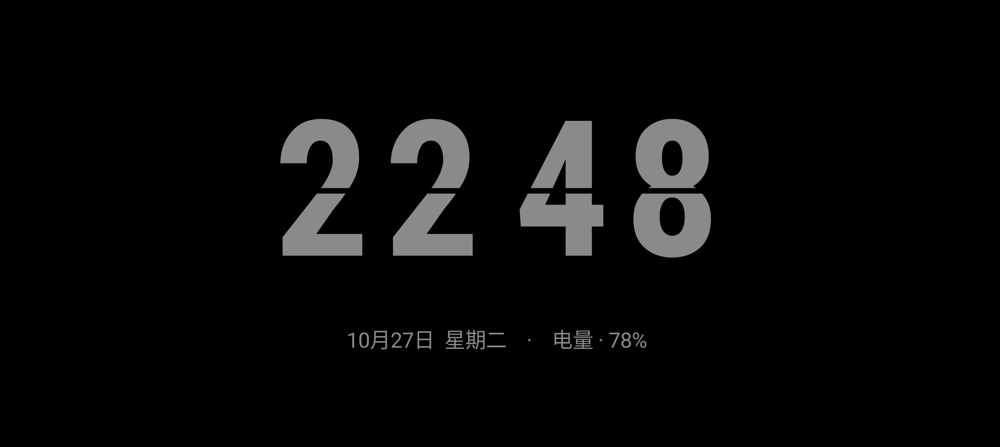

# 静夜时钟 · QuietClock

一个轻量的原生 Android 横屏翻页时钟，当前版本为 **0.1.3**。

## 界面效果



效果图由应用实际绘制代码生成，时间、日期和电量为示例。界面会定时整体位移；实际显示亮度取决于设备及亮度设置。

## 功能

- 纯黑背景，小时和分钟分别显示，数字中央保留黑色折痕。
- 数字变化时播放短暂翻页动画，小时与分钟牌面背景同步出现，动画结束后恢复纯黑。
- 显示日期、电量及充电状态，遵循系统的12/24小时格式。
- 时间、日期和电量整体位移，每分钟小幅偏移、每10分钟轮换较大的位置，并限制在显示区域内。
- 支持180°旋转，保存用户选择。
- 普通亮度可调，默认5%。
- 每日定时夜间模式，默认23:00至次日07:00，可自定义并跨午夜。
- 夜间默认亮度4%，可调至手机最低亮度或1%至10%；夜间不播放翻页动画。
- 自动结束可选择30分钟、1小时或2小时，设置中显示剩余时间和预计结束时刻，也可取消。
- 自适应应用图标与单色主题图标。

应用需要保持屏幕点亮，不接管系统 AOD。按电源键或切换到后台后，手机可以正常熄屏。位置变化只能分散固定区域的显示时间，不能保证避免 OLED 烧屏；实际亮度和耗电需要在具体设备上测试。

## 隐私

- 应用不声明联网权限，不集成广告、统计或第三方分析 SDK。
- 仅在设备本地读取系统时间、电量和充电状态。
- 亮度、旋转与夜间时间段等设置使用本地 `SharedPreferences` 保存。
- 不需要账号、定位、相机、麦克风、通讯录、无障碍或悬浮窗权限。

本机 SDK 路径、构建缓存、日志、签名私钥和生成的安装包不属于源码提交内容。`local.properties`、签名文件及本地配置由 `.gitignore` 排除。

## 构建

需要：

- JDK 17
- Android SDK Platform 35
- Android SDK Build Tools 35.0.0

项目使用 Android Gradle Plugin 8.9.2，已包含 Gradle Wrapper，固定 Gradle 8.11.1 并配置发行包 SHA-256 校验。

可以用 Android Studio 打开项目并配置 JDK 和 SDK。也可以配置好 `JAVA_HOME`、`ANDROID_HOME` 后在项目根目录运行：

```sh
./gradlew :app:assembleDebug :app:lintDebug :app:testDebugUnitTest
```

Windows 使用 `gradlew.bat`。

首次构建与测试需要下载依赖。`local.properties` 由开发者在本机配置，不应提交到仓库。

测试 APK 输出位置：

```text
app/build/outputs/apk/debug/app-debug.apk
```

测试构建会使用开发者本机的调试签名。仓库不包含私钥；正式发行应使用自行保管的签名。

## 测试与实现

- 13项 Android 行为模拟回归测试，覆盖启动、触控、暂停恢复、弹窗亮度、旋转、倒计时、布局缓存、图标及夜间亮度升级和保存。
- 行为测试基于 Robolectric，在 JVM 中模拟 Android 15（API 35），不能替代真机测试。
- 绘制布局、字体度量和数字拆分结果缓存，在尺寸、字体配置、内容或位置变化时更新。
- 夜间时段按本地时间计算，开始包含、结束不包含；修改系统时间或时区后重新判断。
- 实际最低亮度、系统适配、耗电、温度及长时间运行表现仍需在设备上验证。

## 版本记录

- **0.1.3**：夜间默认亮度由2%提高至4%，兼容旧版设置升级，保留后续手动调整。
- **0.1.2**：增加夜间亮度滑块。
- **0.1.1**：完善自动结束状态、增加应用图标、缓存绘制布局。
- **0.1**：横屏翻页时钟原型。

## 许可证

静夜时钟的原创代码与资源采用 [MIT License](LICENSE)，版权署名为 `Copyright (c) 2026 lucifly`。该许可也适用于本仓库已发布的 0.1.3 APK 中的原创部分。

Gradle Wrapper 及其他第三方组件保留各自的许可证；随仓库分发的 Gradle Wrapper 使用 Apache-2.0，许可证副本见 [licenses/Apache-2.0.txt](licenses/Apache-2.0.txt)。
